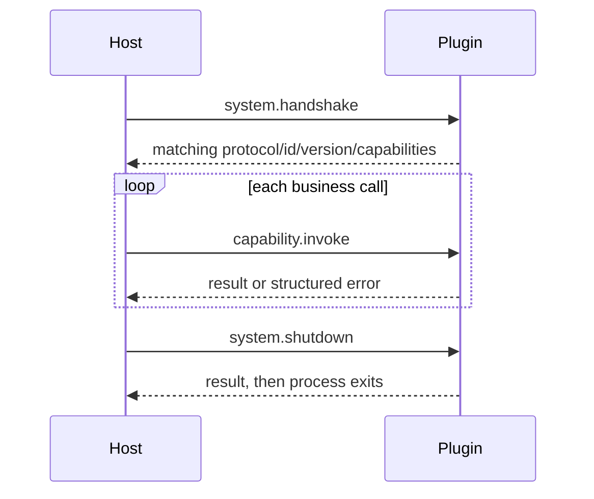

# Plugin Development

[Handbook](../README.md) · [中文](../zh-CN/plugin-development.md) · [Plugin Usage](plugin-usage.md)

Lum Harbor Plugin Runtime V1 is an out-of-process extension boundary. There is no published Plugin SDK: each Plugin owns small local wire structs and implements the frozen stdio protocol. Use `lh-plugin-base` from the companion Plugin sources as the minimal Go reference and the four official Plugins as capability examples.

## Project shape

```text
my-plugin/
├── plugin.json          manifest and configuration schema
├── main.go              or native source such as Sources/.../main.swift
├── Makefile             build, package, test where applicable, clean
├── README.md            capability and operator documentation
└── dist/
    ├── my-plugin/       staged artifact: manifest + executable/resources
    └── my-plugin.lhplugin
```

The executable may be a regular binary or a platform bundle whose relative entry point is named by `executable`.

## Manifest fields

Only fields implemented by [`Manifest`](../../../internal/plugin/manifest.go) are supported:

| Field | Meaning |
|---|---|
| `packageFormatVersion` | Optional package-layout version; `0`/omitted and `1` are accepted, packaged Plugins should declare `1`. |
| `os`, `arch` | Optional compatibility lists. Omission means portable to any OS/architecture, so native packages must declare truthful values. |
| `manifestVersion` | Required; V1 is `1`. |
| `id` | Stable lowercase identity matching `^[a-z0-9]+(?:[._-][a-z0-9]+)*$`. |
| `name`, `version` | Display name and extension version. |
| `protocolVersion` | Required; V1 is `1`. |
| `executable` | Relative contained entry point. Absolute paths and escapes are rejected. |
| `capabilities` | Unique Capability declarations. `read.query` additionally requires bounded `description`, `inputSemantics`, and `resultSemantics`. |
| `bindings` | Optional `SCHEDULE`, `AI_PRE`, `AI_PROVIDER`, or `AI_POST` declarations. |
| `configuration` | Version `1` flat schema with `string`, `number`, `boolean`, `enum`, or `secret` fields. |

Unknown JSON fields are rejected. A manifest declares availability and usage metadata; the Host-owned Go contract defines each wire payload.

Example:

```json
{
  "packageFormatVersion": 1,
  "os": ["darwin"],
  "arch": ["arm64"],
  "manifestVersion": 1,
  "id": "lh-plugin-example",
  "name": "Example Source",
  "version": "0.1.0",
  "protocolVersion": 1,
  "executable": "lh-plugin-example",
  "capabilities": [{ "id": "source.fetch" }],
  "bindings": [{
    "id": "poll",
    "type": "SCHEDULE",
    "capability": "source.fetch",
    "defaultIntervalSeconds": 300
  }],
  "configuration": { "version": 1 }
}
```

Capability means what the Plugin can do. Binding means where or when the Host uses it. Do not invent `SourcePlugin`, `AIPlugin`, or other Plugin classes.

## Process and RPC lifecycle

The Host starts one long-running child process per selected extension, shared by its enabled Instances. The process working directory is the installed extension directory.

- stdin: newline-delimited Host requests;
- stdout: newline-delimited JSON protocol responses only;
- stderr: diagnostic logs only.



A request is `{ "id", "method", "params" }`. A response repeats `id` and contains exactly one of `result` or `error: { "code", "message" }`. Business `capability.invoke` params are:

```json
{
  "capabilityId": "source.fetch",
  "instanceId": "lh-plugin-example-...",
  "config": {},
  "input": {}
}
```

Handshake result must exactly match manifest protocol version, extension ID/version, and sorted Capability set. Malformed frames, duplicate or unknown response IDs, and result-plus-error are fatal protocol violations. Calls can time out; late responses are tolerated only while their bounded request-ID tombstone remains retained. V1 has no remote per-call cancellation or automatic process restart.

## Host-supported Capabilities

### `source.fetch`

Called by a Host-owned Scheduler workload. Input contains optional `cursor` and string `context`. Result contains `records` and optional `nextCursor`; each record has `externalId`, `sourceKind`, `observedAt`, optional `sourceUpdatedAt`, and JSON `payload`.

The Plugin observes external facts. It does not persist Source rows, advance the durable checkpoint, reconcile Planner state, or write domain truth. Apple Reminders is the native example; Synthetic Project and `lh-plugin-base` are Go examples.

### `read.query`

Called through the Plugin read adapter when Assistant chooses a Plugin-provided read. Input is `{ "query": "..." }`, an opaque non-empty string of at most 500 Unicode characters. Result is `{ "summary", "facts": [{"name", "value"}] }` with Host-enforced bounds: summary 2,000 characters, at most 20 facts, names 100, values 500.

It provides bounded read-only facts. It is not SQL, an expression language, a nested document API, or a mutation callback. Synthetic Project is the richest current example; `lh-plugin-base` is minimal.

### `ai.pre_request`

Called by central `ai.Service` before provider execution for matching actions. Input is the canonical AI request: `requestId`, `action`, `messages`, `outputSchema`, and optional string metadata. Result uses `decision`: `CONTINUE` with no payload, `REPLACE` with a replacement request, or `STOP` with a response.

The Plugin may perform bounded middleware transformation. It receives no DB handle or Host object and cannot bypass output validation or domain Proposal rules.

### `ai.provider`

Called by `ai.Service` as the single effective provider. Input is the same canonical request; result contains `requestId`, `action`, JSON `output`, optional usage, and metadata. `lh-plugin-ai-runtime` is the official example.

It provides model execution for Assistant and background Source Processing. It does not receive SQLite, and its semantic output never gains direct mutation authority. Provider failure is returned; the Host does not silently fall back.

### `ai.post_response`

Called after provider execution for matching actions. Input is the canonical response. Result is `CONTINUE`, or `REPLACE`/`STOP` with a response. The Host restores runtime-owned provenance and validates invariants after Plugin output.

No official production Plugin currently declares PRE or POST; use the Host adapter tests as implementation evidence rather than inventing an SDK.

### `notification.deliver`

Called by the notification delivery cycle only after Core has created and sent the durable in-app Notification. Input is `deliveryId`, `title`, `message`, and `urgency` (`NORMAL` or `CRITICAL`). Success is an empty object; inability to ensure delivery must be an RPC error.

The Plugin performs one bounded external side effect and must make repeated calls with the same stable `deliveryId` idempotent. It does not decide whether a Notification should exist and does not mutate Notification or Attention truth. `lh-plugin-macos-notifications` is the official example.

## Runtime filesystem and environment

The Host injects:

| Variable | Meaning |
|---|---|
| `LUM_HARBOR_PLUGIN_ID` | Validated extension ID |
| `LUM_HARBOR_PLUGIN_VERSION` | Manifest version |
| `LUM_HARBOR_PLUGIN_INSTALL_DIR` | Absolute installed package directory |
| `LUM_HARBOR_PLUGIN_DATA_DIR` | Private `0700` persistent data directory |
| `LUM_HARBOR_PLUGIN_CACHE_DIR` | Private `0700` cache directory |

Write durable Plugin state only under `LUM_HARBOR_PLUGIN_DATA_DIR`; use the cache directory for disposable data. Do not mutate the install directory. Plugins must never locate, read, or write `lum_harbor.db`, and must not expect repositories, domain services, Scheduler ownership, or reentrant Host tools.

## Build and package official examples

The official Plugin sources are not bundled in this application repository. From a directory containing the companion Plugin checkouts:

```sh
# Go Plugins
make -C lh-plugin-ai-runtime test
make -C lh-plugin-ai-runtime package
make -C lh-plugin-synthetic-project test
make -C lh-plugin-synthetic-project package

# Swift/macOS Plugins
make -C lh-plugin-apple-reminders package
make -C lh-plugin-macos-notifications package

# Minimal Go reference (directory artifact, not an end-user package)
make -C lh-plugin-base test
make -C lh-plugin-base clean
make -C lh-plugin-base
```

Current Plugin `make package` targets build a staged artifact, ZIP `plugin.json` plus the declared executable/resources, and copy a canonical `dist/<plugin-id>.lhplugin`. The application installer—not the Makefile—performs package safety, manifest, OS/architecture, and executable validation at installation time.

## Local compatibility tests

From the `lum-harbor-notifier` repository, the convenience `*-local` targets expect the corresponding companion Plugin checkouts as siblings. For any independently built artifact, use the generic target with an explicit absolute path:

```sh
make plugin-compat PLUGIN_COMPAT_ARTIFACT=/absolute/path/to/plugin-or-package
make plugin-compat-local
make synthetic-plugin-compat-local
make ai-plugin-compat-local
make reminders-plugin-compat-local
make notifications-plugin-compat-local
```

Reminders testing is macOS/TCC-gated and needs previously granted EventKit access. Notifications testing performs a real native delivery and therefore needs macOS permission. `plugin-compat-local-windows` validates a cross-built Windows reference artifact without executing it.

## Minimal new-Plugin walkthrough

1. Copy the structure—not application internals—from `lh-plugin-base` into an independent project.
2. Give it a new stable manifest ID and executable name.
3. Declare only Capabilities you implement and add bindings only where the Host supports them.
4. Implement `system.handshake`, `capability.invoke`, and `system.shutdown`; keep stdout protocol-only.
5. Decode the Host-owned typed input, validate it, perform bounded work, and return the exact typed result or a structured error.
6. Add deterministic black-box tests for framing, correlation, EOF/shutdown, invalid input, and stdout/stderr separation.
7. Build into `dist/<plugin-id>/`, create a root-layout `.lhplugin`, and inspect it with `unzip -l`.
8. Install it through Lum Harbor, restart, Add Instance, configure, restart, and observe `lum-harbor.log` plus product behavior.
9. For a Core compatibility test, pass an absolute artifact path to `make plugin-compat PLUGIN_COMPAT_ARTIFACT=...`; do not make the application test suite build your project implicitly.

Use `lh-plugin-apple-reminders` for `source.fetch`, Synthetic Project for combined Source/read behavior and persistent data, AI Runtime for `ai.provider`, and macOS Notifications for a platform bundle plus bounded side effect.

## Package safety and current limits

The installer rejects path traversal, drive-letter paths, symlinks, duplicate entries, special files, unsupported format/platform metadata, missing manifests/executables, packages over 10,000 entries, files over 200 MB, and total extracted content over 500 MB. Existing destinations are not overwritten.

Platform compatibility note: All four official Plugin manifests explicitly declare truthful `os` and `arch` metadata (e.g. `os: ["darwin"]`, `arch: ["arm64"]` for Darwin Mach-O arm64 binaries), strictly matching their package filenames (`darwin-arm64`). The installer enforces platform compatibility and rejects incompatible hosts with `ErrIncompatiblePlatform`.

V1 does not provide signing/PKI, sandboxing, marketplace distribution, update/replace, streaming, remote cancellation, automatic restart, Plugin credential persistence, or a general bidirectional Host tool API.
