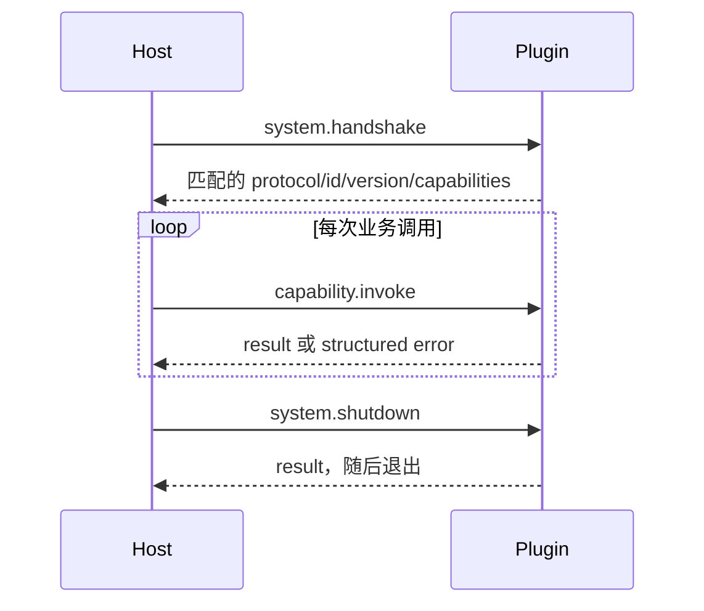

# Plugin 开发指南

[项目手册](../README.zh-CN.md) · [English](../en/plugin-development.md) · [Plugin 使用指南](plugin-usage.md)

Lum Harbor Plugin Runtime V1 是一个进程外扩展边界。目前没有发布独立 Plugin SDK：每个 Plugin 定义少量本地 wire struct，并实现冻结的 stdio 协议。配套 Plugin 源码中的 `lh-plugin-base` 是最小 Go 参考；四个官方 Plugin 则分别展示不同 Capability。

## 项目结构

```text
my-plugin/
├── plugin.json          manifest 与配置 schema
├── main.go              或 Sources/.../main.swift 等原生源码
├── Makefile             build、package、适用时的 test、clean
├── README.md            Capability 与运维说明
└── dist/
    ├── my-plugin/       staging artifact：manifest + executable/resources
    └── my-plugin.lhplugin
```

`executable` 可以指向普通二进制，也可以指向 platform bundle 内的相对入口。

## Manifest 字段

只支持 [`Manifest`](../../../internal/plugin/manifest.go) 中已经实现的字段：

| 字段 | 含义 |
|---|---|
| `packageFormatVersion` | 可选的包布局版本；省略/`0` 和 `1` 均被接受，可安装包应显式声明 `1`。 |
| `os`、`arch` | 可选兼容列表。省略表示适用于任意 OS/架构，因此原生包必须如实填写。 |
| `manifestVersion` | 必填；V1 为 `1`。 |
| `id` | 稳定小写身份，匹配 `^[a-z0-9]+(?:[._-][a-z0-9]+)*$`。 |
| `name`、`version` | 显示名与 Extension 版本。 |
| `protocolVersion` | 必填；V1 为 `1`。 |
| `executable` | 包内相对入口；绝对路径和越界路径会被拒绝。 |
| `capabilities` | 唯一的 Capability 声明；`read.query` 还必须给出有长度上限的 `description`、`inputSemantics`、`resultSemantics`。 |
| `bindings` | 可选的 `SCHEDULE`、`AI_PRE`、`AI_PROVIDER`、`AI_POST` 声明。 |
| `configuration` | 版本 `1` 的扁平配置 schema，字段类型为 `string`、`number`、`boolean`、`enum` 或 `secret`。 |

未知 JSON 字段会被拒绝。Manifest 只声明可用性与使用说明，具体 payload 仍由 Host 的 Go contract 定义。

```json
{
  "packageFormatVersion": 1,
  "os": ["darwin"],
  "arch": ["arm64"],
  "manifestVersion": 1,
  "id": "lh-plugin-example",
  "name": "Example Source",
  "version": "0.1.0",
  "protocolVersion": 1,
  "executable": "lh-plugin-example",
  "capabilities": [{ "id": "source.fetch" }],
  "bindings": [{
    "id": "poll",
    "type": "SCHEDULE",
    "capability": "source.fetch",
    "defaultIntervalSeconds": 300
  }],
  "configuration": { "version": 1 }
}
```

Capability 表示 Plugin 能做什么；Binding 表示 Host 在何处或何时使用它。不要重新引入 `SourcePlugin`、`AIPlugin` 等类型分类。

## 进程与 RPC 生命周期

Host 为每个已选择的 Extension 启动一个长期子进程，其多个已启用 Instance 共享该进程。工作目录是 Extension 安装目录。

- stdin：Host 发来的逐行 JSON 请求；
- stdout：只能输出逐行 JSON 协议响应；
- stderr：只能输出诊断日志。



Request 为 `{ "id", "method", "params" }`；Response 必须复用 `id`，并且只能包含 `result` 或 `error: { "code", "message" }` 之一。业务调用的 `capability.invoke` params：

```json
{
  "capabilityId": "source.fetch",
  "instanceId": "lh-plugin-example-...",
  "config": {},
  "input": {}
}
```

Handshake result 必须与 manifest 的 protocol version、Extension ID/version 和排序后的 Capability 集合完全一致。Malformed frame、重复/未知 response ID、同时返回 result 与 error 都是致命协议错误。调用可能超时；只有在有界 request-ID tombstone 尚未过期时，迟到响应才会被安全丢弃。V1 没有远程单次调用取消或自动进程重启。

## Host 支持的 Capability

### `source.fetch`

由 Host 所有的 Scheduler workload 调用。Input 含可选 `cursor` 和字符串 `context`。Result 含 `records` 与可选 `nextCursor`；每条 record 包含 `externalId`、`sourceKind`、`observedAt`、可选 `sourceUpdatedAt` 和 JSON `payload`。

Plugin 只观察外部事实，不持久化 Source、不提交 durable checkpoint、不协调 Planner，也不写领域真值。Apple Reminders 是原生实现示例；Synthetic Project 与 `lh-plugin-base` 是 Go 示例。

### `read.query`

当 Assistant 选择 Plugin read 时，经 Plugin read adapter 调用。Input 为 `{ "query": "..." }`，是不透明非空文本，最长 500 个 Unicode 字符。Result 为 `{ "summary", "facts": [{"name", "value"}] }`，Host 强制上限：summary 2,000 字符、最多 20 条 fact、name 100 字符、value 500 字符。

它只提供受限只读事实，不是 SQL、表达式语言、嵌套文档 API 或 mutation callback。Synthetic Project 是当前最完整的示例，`lh-plugin-base` 是最小示例。

### `ai.pre_request`

由中央 `ai.Service` 在 Provider 执行前按 action 调用。Input 为标准 AI request：`requestId`、`action`、`messages`、`outputSchema` 和可选字符串 metadata。Result 的 `decision` 可以是：无 payload 的 `CONTINUE`；携带 replacement request 的 `REPLACE`；携带 response 的 `STOP`。

Plugin 可以做受限 middleware 转换，但不会获得 DB handle 或 Host object，也不能绕过输出校验与 Proposal 规则。

### `ai.provider`

由 `ai.Service` 作为唯一有效 Provider 调用。Input 同样是标准 request；Result 含 `requestId`、`action`、JSON `output`、可选 usage 和 metadata。官方示例是 `lh-plugin-ai-runtime`。

它为 Assistant 和后台 Source Processing 提供模型执行，但不会获得 SQLite，语义输出也没有直接 mutation 权限。Provider 失败会原样失败，不会静默回退。

### `ai.post_response`

Provider 执行后按 action 调用。Input 为标准 response；Result 为 `CONTINUE`，或携带 response 的 `REPLACE`/`STOP`。Plugin 输出后，Host 会恢复 runtime-owned provenance 并继续校验不变量。

当前没有官方生产 Plugin 声明 PRE/POST；应以 Host adapter tests 为实现依据，不要虚构 SDK。

### `notification.deliver`

只有 Core 已创建并发送 durable in-app Notification 后，notification delivery cycle 才会调用。Input 为 `deliveryId`、`title`、`message` 和 `urgency`（`NORMAL`/`CRITICAL`）。成功 Result 是空对象；无法确保投递时必须返回 RPC error。

Plugin 只执行一个受限外部副作用，并必须以稳定 `deliveryId` 保证重复调用幂等。它不决定 Notification 是否应该存在，也不修改 Notification/Attention 真值。官方示例是 `lh-plugin-macos-notifications`。

## Runtime 文件系统与环境变量

Host 注入：

| 环境变量 | 含义 |
|---|---|
| `LUM_HARBOR_PLUGIN_ID` | 已校验的 Extension ID |
| `LUM_HARBOR_PLUGIN_VERSION` | Manifest version |
| `LUM_HARBOR_PLUGIN_INSTALL_DIR` | 绝对安装目录 |
| `LUM_HARBOR_PLUGIN_DATA_DIR` | 私有 `0700` 持久数据目录 |
| `LUM_HARBOR_PLUGIN_CACHE_DIR` | 私有 `0700` 缓存目录 |

持久状态只能写入 data 目录；可丢弃内容写入 cache。不要改写安装目录。Plugin 绝不能定位、读取或写入 `lum_harbor.db`，也不能期待获得 Repository、Domain Service、Scheduler ownership 或可重入 Host tool。

## 构建与打包官方示例

官方 Plugin 源码不包含在此应用仓库中。请在包含配套 Plugin checkout 的目录中运行：

```sh
# Go Plugins
make -C lh-plugin-ai-runtime test
make -C lh-plugin-ai-runtime package
make -C lh-plugin-synthetic-project test
make -C lh-plugin-synthetic-project package

# Swift/macOS Plugins
make -C lh-plugin-apple-reminders package
make -C lh-plugin-macos-notifications package

# 最小 Go 参考（目录 artifact，不是面向用户的 package）
make -C lh-plugin-base test
make -C lh-plugin-base clean
make -C lh-plugin-base
```

当前 `make package` 会构建 staging artifact，把 `plugin.json` 和声明的 executable/resources 打成 ZIP，并复制标准 `dist/<plugin-id>.lhplugin`。安全、manifest、OS/架构与 executable 校验由应用 Installer 在安装时完成，不由 Makefile 完成。

## 本地兼容性测试

在 `lum-harbor-notifier` 仓库中，便捷的 `*-local` target 依赖对应的配套 Plugin checkout 位于同级目录。对于任何独立构建的产物，请使用通用 target 并显式传入绝对路径：

```sh
make plugin-compat PLUGIN_COMPAT_ARTIFACT=/absolute/path/to/plugin-or-package
make plugin-compat-local
make synthetic-plugin-compat-local
make ai-plugin-compat-local
make reminders-plugin-compat-local
make notifications-plugin-compat-local
```

Reminders 测试受 macOS/TCC 控制，需要事先授权 EventKit；Notifications 测试会真实投递系统通知，需要 macOS 权限。`plugin-compat-local-windows` 只验证交叉构建的 Windows 参考 artifact，不执行它。

## 开发一个最小 Plugin

1. 以 `lh-plugin-base` 的结构为参考，但不要复制应用内部包。
2. 设置新的稳定 manifest ID 与 executable 名称。
3. 只声明实际实现的 Capability，只添加 Host 已支持的 Binding。
4. 实现 `system.handshake`、`capability.invoke`、`system.shutdown`，确保 stdout 只有协议。
5. 解码并校验 Host-owned typed input，执行有界工作，返回精确 typed result 或 structured error。
6. 为 framing、correlation、EOF/shutdown、非法 input、stdout/stderr 分离编写确定性黑盒测试。
7. 构建 `dist/<plugin-id>/`，创建 root-layout `.lhplugin`，用 `unzip -l` 检查内容。
8. 通过 Lum Harbor 安装、重启、Add Instance、配置、再重启，并观察 `lum-harbor.log` 与产品行为。
9. 如需 Core 兼容性测试，用绝对路径执行 `make plugin-compat PLUGIN_COMPAT_ARTIFACT=...`；不要让应用测试套件隐式构建外部项目。

`lh-plugin-apple-reminders` 适合参考 `source.fetch`；Synthetic Project 适合参考 Source/read 与持久数据；AI Runtime 适合参考 `ai.provider`；macOS Notifications 适合参考 platform bundle 与受限副作用。

## 包安全与当前限制

Installer 会拒绝路径逃逸、Windows drive-letter path、symlink、重复 entry、特殊文件、不支持的格式/平台元数据、缺失 manifest/executable、超过 10,000 个条目的包、单文件超过 200 MB、总解压大小超过 500 MB。已有目标目录不会被覆盖。

平台兼容性说明：全部四个官方 Plugin 的 manifest 均明确声明了真实的 `os` 与 `arch` 元数据（例如针对 Darwin Mach-O arm64 二进制声明 `os: ["darwin"]`、`arch: ["arm64"]`），与其包文件名（`darwin-arm64`）严格对齐。Installer 会执行平台兼容性校验，在不兼容的主机系统上以 `ErrIncompatiblePlatform` 拒绝安装。

V1 没有签名/PKI、沙箱、marketplace、update/replace、streaming、远程取消、自动重启、Plugin credential persistence 或通用双向 Host tool API。
