# Lum Harbor 产品使用指南

[项目手册](../README.zh-CN.md) · [English](../en/product-guide.md) · [Plugin 使用指南](plugin-usage.md) · [故障排查](runtime-and-troubleshooting.md)

Lum Harbor 是一款 local-first 工作驾驶舱，把长期工作、日常 Todo、外部事实、AI 辅助理解、提醒、通知和可解释的 History 放进同一个桌面应用。

核心规则很简单：

> AI 负责理解与提出建议；你负责审查；Lum Harbor 才执行权威变更。

本指南描述当前 V1 的真实行为。所有截图均来自原生应用与 Synthetic acceptance workspace，不是设计稿或伪造界面。

## 1. 核心概念与主界面

Lum Harbor 主要回答三个问题：

- 我负责哪些工作？
- 现在最需要关注什么？
- 这个条目、提醒或通知为什么出现？

权威状态保存在本机。外部系统与 Plugin 提供证据，但不能直接写入 WorkItem、Workflow 或 Planner 真值。结构化集成可以通过确定性规则同步；AI 产生的语义变更必须先成为 Proposal，由用户审查。

- **WorkItem**：持续较长时间的交付结果，如发布、迁移或项目。
- **Workflow**：一个 WorkItem 的有序阶段序列。
- **Tracked Item**：沿 Workflow 推进的工作单元。
- **Planner Todo**：可以排期并完成的具体行动。
- **Reminder / MonitorPoint**：针对时间或进度的明确期望。
- **Attention**：当前有事项需要关注的系统状态。
- **Notification**：把 Attention 告知用户的通信记录。
- **History**：记录发生了什么，以及事实之间如何关联。

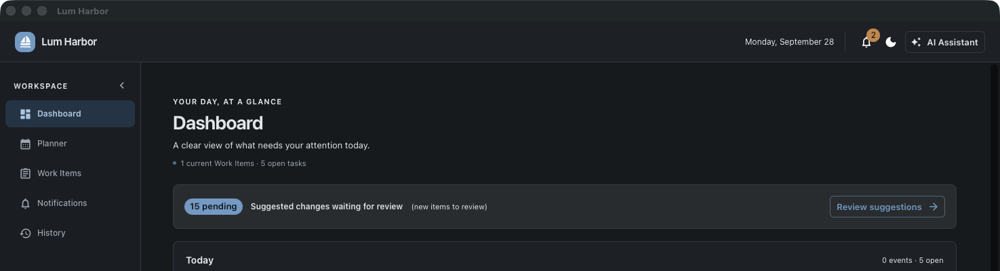

Dashboard 是打开应用后的方向盘，显示今日工作、当前 WorkItem、活动 Workflow 和待审 Suggested Changes，但不会自行 Apply Proposal。

左侧导航包含 **Dashboard**、**Planner**、**Work Items**、**Notifications**、**History** 与 **Settings**。右上角打开 **AI Assistant**；当前页面或选中的 WorkItem 只是上下文提示，不是权限边界。

| 区域 | 用途 |
|---|---|
| **Dashboard** | 今日行动、当前 WorkItem、活动 Workflow 与待审变更的快速总览。 |
| **Planner** | 查看有精确时间、仅日期或无日期的 Todo，并完成本地 Todo。 |
| **Work Items** | 管理长期目标、Workflow、Tracked Item、依赖、MonitorPoint 与 scoped History。 |
| **Notifications** | 查看持久通知、未读状态、操作、snooze 与关联对象。 |
| **History** | 通过 Timeline、Traces、Audit 解释系统行为。 |
| **AI Assistant** | 提问，并生成、审查 Proposal。 |
| **Settings** | 外观、AI runtime、Plugin、Instance 与运行状态。 |

当前 Settings 中真正接入后端的是 Plugin inventory/management 与 AI runtime；标为 preview 或 coming later 的卡片不是已生效的配置面。

## 2. 首次设置与 AI

首次使用建议：

1. 打开 **Settings**。
2. 如需 AI，进入 **AI** 配置 Provider。
3. 如需集成，在 **Extensions** 中添加 `.lhplugin`。
4. 安装后重启，再创建 Plugin Instance，随后再次重启。
5. 先用 Assistant 提一个只读问题，确认 runtime 正常，再创建变更 Proposal。

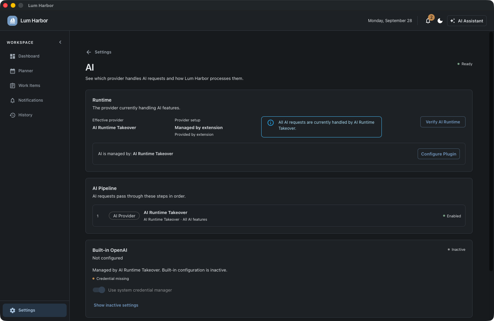

Lum Harbor 支持两条 Provider 路径：

- **Built-in OpenAI**：配置 OpenAI-compatible endpoint、model、request timeout 与安全存储的 credential。
- **Plugin AI Runtime**：已启用的 `ai.provider` Instance 接管所有 AI 请求，内置 Provider 会显示为 inactive。

一次只有一个有效 Provider。使用 **Verify AI Runtime** 测试当前路由；UI 永远不会把已保存 API key 读回显示。

本地 Ollama 可通过 OpenAI-compatible endpoint 使用，常见地址为 `http://127.0.0.1:11434/v1`。必须填写准确 model name。大型本地模型可能耗时数分钟，且后台 Source interpretation 与 Assistant 共用 Provider；看到 **Thinking…** 时不要立即退出，可在 History 查看最终 AI Run 结果。

相对日期会受模型质量影响。请尽量使用明确日期、时间与 IANA timezone，并在 Proposal Review 中逐项核对。

## 3. Plugin 设置概览

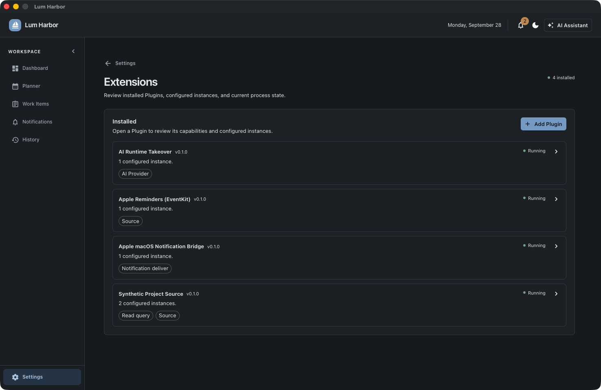

在 **Settings → Extensions → Add Plugin** 中选择 `.lhplugin`。安装与创建 Instance 是两个独立步骤：先安装并重启让 discovery 看到包，再 **Add Instance**、选择 Capability、填写非 secret 配置，然后再次重启让 runtime 生效。

**Stop Using** 与 **Use Again** 都只修改下次启动的配置，不会立即停止或启动共享进程。Remove 前应停用所有 Instance、重启，再执行移除；卸载会保留 Plugin data 与 cache。

官方 Plugin：

- `lh-plugin-ai-runtime`：全局 AI Provider。
- `lh-plugin-apple-reminders`：读取 Apple Reminders 并同步到 Planner。
- `lh-plugin-macos-notifications`：向 macOS Notification Center 投递通知。
- `lh-plugin-synthetic-project`：提供确定性模拟项目 Source 与受限查询。

完整生命周期与权限说明见 [Plugin 使用指南](plugin-usage.md)。

## 4. Assistant 与 Proposal Review

Assistant 可能产生两种结果：

- **Answer**：基于 Core 或 Plugin 事实的只读回答。
- **Suggested Change**：typed Proposal；只有用户选择 **Apply** 后才会修改权威状态。

下面是真实只读结果：Workflow 位于 Testing，但 Assistant 能准确报告每个 Tracked Item 独立派生出的阶段与状态。

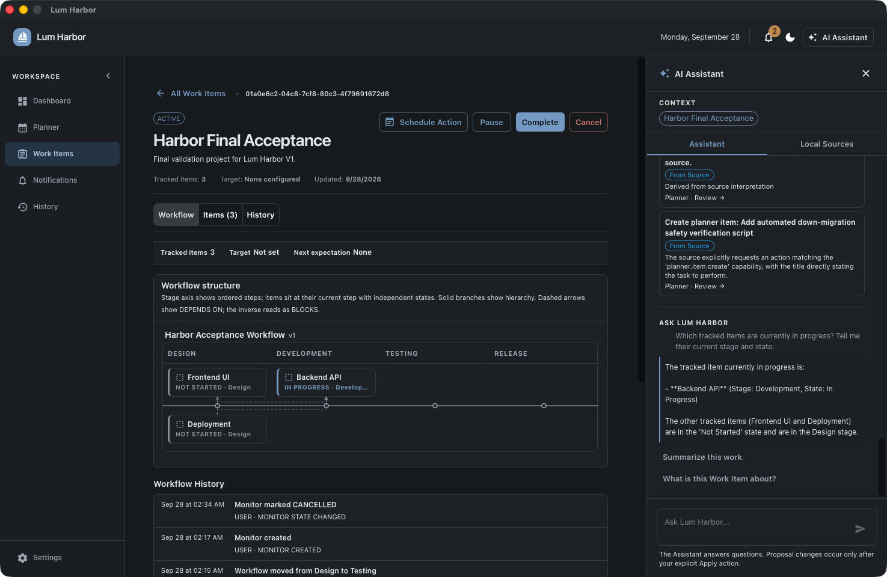

例如输入：

> Create a work item called Product Release.

流程为：记录用户意图 → 调用 AI → 生成 pending Suggested Change → 用户打开 **Needs Review** → 检查理由、Source 和 **Proposed Changes** → Apply 或 Reject。

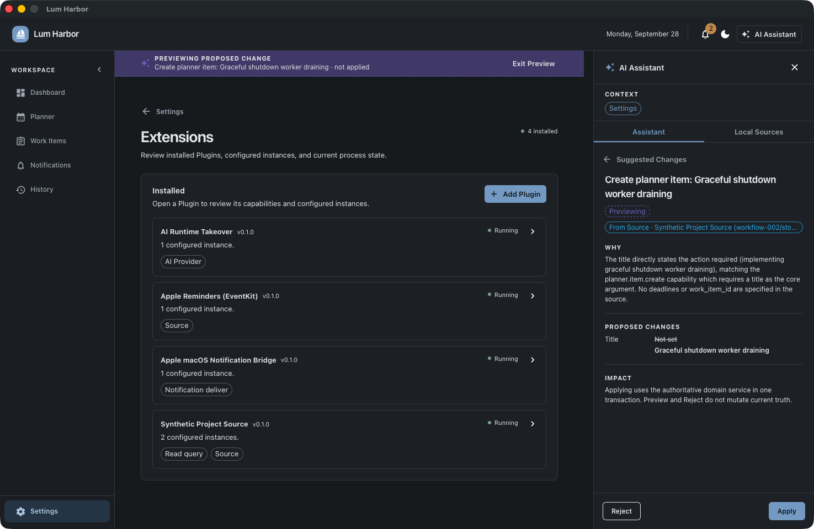

紫色 **Previewing Proposed Change** 只是临时预览，不是已保存真值。Reject 不会修改 WorkItem、Planner 或 Tracking。Apply 会重新读取当前权威状态，并在一次受校验事务中执行；若目标已变化，Proposal 会变为 **STALE**，而不是覆盖新事实。

Lum Harbor 会保留从用户请求、AI Run、Proposal 到最终变更的 provenance。AI 或校验失败时系统 fail closed，不会产生权威 mutation。

## 5. WorkItem

WorkItem 代表持续时间长于单个 Todo 的结果，如发布、功能、迁移或项目目标。

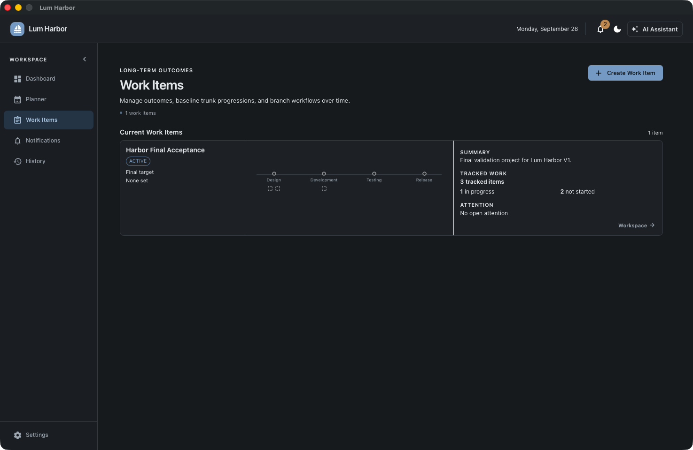

一个 WorkItem 包含 title、可选 description、lifecycle、可选 Workflow、Tracked Item、MonitorPoint 和相关 History。Lifecycle 状态为 **ACTIVE**、**PAUSED**、**COMPLETED**、**CANCELLED**；可见操作按钮提供合法的 Pause、Complete、Cancel、Resume、Reopen 等直接确定性命令。

Title/description 变更必须走 Proposal。支持只改 description、只改 title 或同时修改；未提供的字段保持当前权威值。

**Create Work Item** 支持直接手工创建。更复杂的 description、Workflow、Tracked Item、依赖和 deadline 设置，主要通过 Assistant → Proposal → Apply 完成。

## 6. Workflow

一个 WorkItem 最多有一个 Workflow。Workflow 绑定一份有序且带版本的阶段定义，并独立保存自己的 current step 与实际 start time。

例如在 WorkItem 中请求：

> Create a workflow with Design, Development, Testing, and Release.

审查并 Apply 后，新 Workflow 通常从第一阶段开始。也可以通过 Assistant Proposal 前移或后退 current step：

> Move this workflow into Testing.

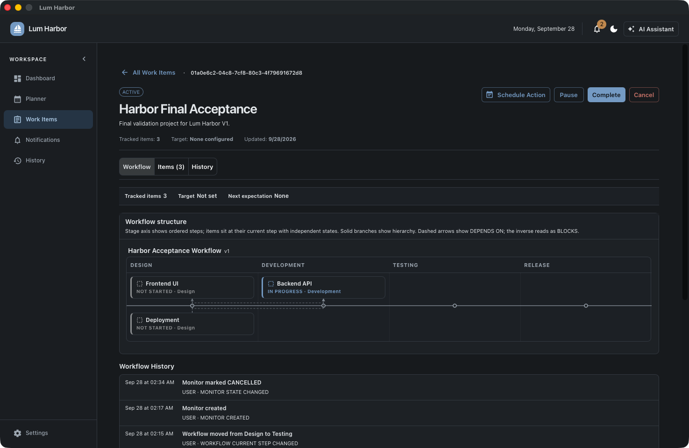

Workflow current step 不等于每个 Tracked Item 的当前阶段。移动 Workflow 不会重写 Tracked Item step state、完成 WorkItem 或完成 Todo。Workflow definition 创建后固定；V1 没有 Workflow edit、migration、deletion、lifecycle 或 completion state。

## 7. Tracked Item 与依赖

Tracked Item 是在 WorkItem Workflow 内推进的工作单元。当前正常路径是通过 Assistant Proposal 一次创建并审查一个，例如：

> Add Backend API as a tracked item.

每个 Tracked Item 都有权威的 per-step state；Lum Harbor 从这些行派生当前位置与总体状态，不存储一个可能漂移的“current status”字段。

常见派生状态包括 **NOT_STARTED**、**IN_PROGRESS**、**BLOCKED**、**WAITING**、**FAILED**、**UNKNOWN**、**COMPLETED**。`SKIPPED` 是合法 step state，在 progression 计算中视为已通过。

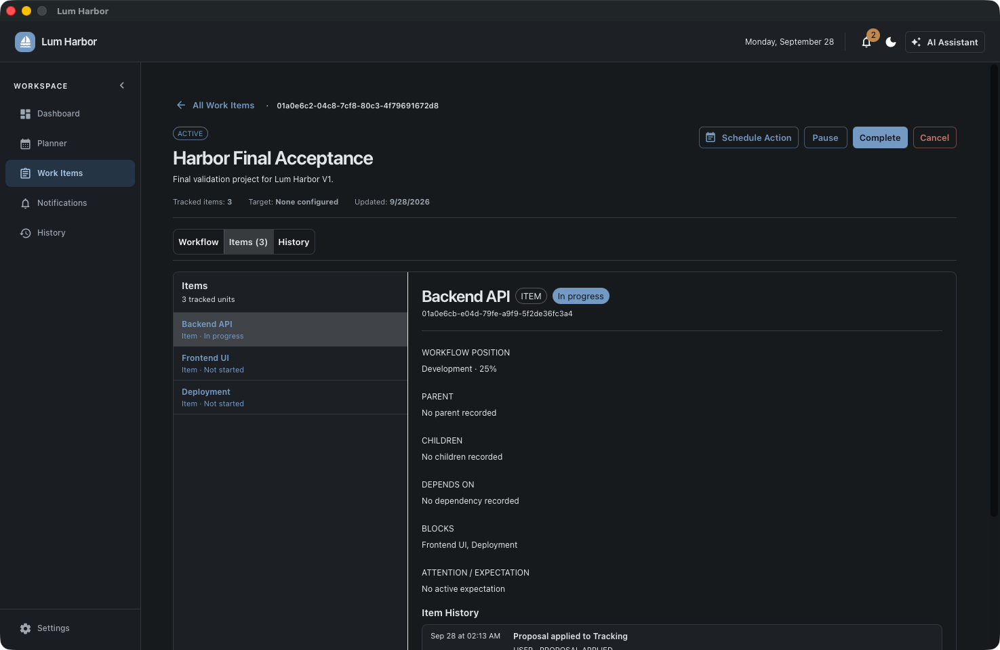

依赖是同一 Workflow 内 active Tracked Item 之间受限的 `DEPENDS_ON` 关系。例如：

> Make Frontend UI depend on Backend API.

系统拒绝 self-dependency、重复关系、跨 Workflow 关系与环。Workflow 图绘制依赖箭头，详情页也会显示反向 **BLOCKS**。改变 Tracked Item 阶段不会移动 Workflow current step，反之亦然。

## 8. Planner 与 Todo

Planner 将 calendar membership 与 **Open** task 视图组合起来。Todo 可以有精确时间、仅日期，或无日期；有日期的条目出现在 Calendar，无日期但仍 open 的条目保留在 **Open**。

通过 Assistant 创建：

> Create a Todo to verify the Backend API on October 2, 2026 at 3 PM America/Chicago.

在 WorkItem 中使用 **Schedule Action**，可创建带 WorkItem、Workflow 和当前 Workflow step provenance 的本地 Todo。

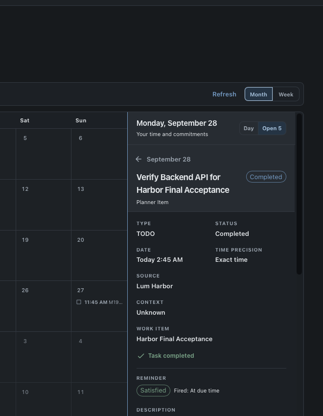

本地 Todo 可通过 checkbox 或详情操作完成。由外部 Source 管理的 Todo 在 Lum Harbor 中只读，必须在来源应用中完成。

V1 没有通用 Planner edit、archive/delete 或 reopen 控件，也没有 recurring Todo engine。新 Proposal 的 title/date 不正确时，应 Reject 并请求修正后的 Proposal。

## 9. Reminder

Todo Reminder 是持续观察某个 Todo 的意图，并不等于 Notification。本身有日期的 Todo 可配置多个 threshold，例如提前数日、提前一天或 **At due time**。

```text
Todo → Reminder → Attention → Notification
```

如果应用离线期间跨过多个 threshold，V1 最多补发最近一个已过阈值，避免旧提醒集中刷屏。

完成 Todo 会把 Reminder 标为 **SATISFIED**、阻止未来 threshold、解决关联的 open Attention，并保留既有 Notification 作为通信记录；不会自动推进 Workflow。无日期 Todo 可以存在，但在设置日期前无法形成有意义的时间 Reminder。

## 10. MonitorPoint

MonitorPoint 是针对 WorkItem 或 Tracked Item 的明确期望：在某个时间前达到目标。例如要求 WorkItem 在指定时间前 COMPLETED，或要求某个 Tracked Item 的 Release step 完成。

通过 Assistant 与 Proposal Review 创建：

> Create a deadline requiring this WorkItem to be completed by October 2, 2026 at 5 PM America/Chicago.

状态为 **ACTIVE**、**SATISFIED**、**CANCELLED**。Overdue 是由 deadline、当前时间和未满足期望派生出的条件，并不是存储状态。到期且未满足时，Scheduler 会创建 Attention 和 Notification；满足期望或取消 MonitorPoint 后，相关 Attention 会解决。终态 MonitorPoint 在 V1 中不能重新激活。

## 11. Attention 与 Notifications

- **Attention** 是当前需要处理事项的系统状态，可 open、resolved 或暂时 snoozed。
- **Notification** 是告知 Attention 的持久通信记录；底层 Attention 已解决后，它仍可保留并维持 unread。

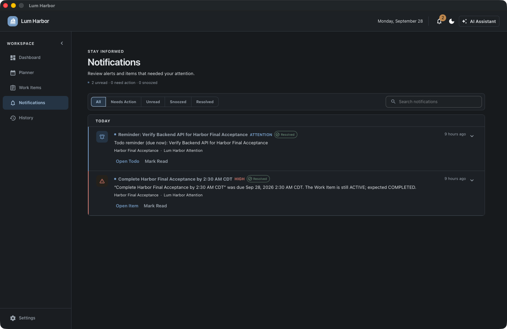

呈现方式包括应用内 toast、Notifications 页面与 header unread badge，以及通过 `lh-plugin-macos-notifications` 发送的 macOS Notification Center 通知。

**Open Todo** 或 **Open Item** 会导航到关联对象。**Mark Read** 只改变阅读状态，不会解决 Attention 或完成工作。Snooze 只暂时抑制呈现，不修改底层真值。

macOS 上需授权 Lum Harbor Notification Bridge。NORMAL 使用标准呈现；CRITICAL/SEVERE 使用更强的 subtitle 与提示音。Lum Harbor 不声称拥有 Apple Critical Alert entitlement。

## 12. Apple Reminders

Apple Reminders Plugin 是只读集成。安装后创建 `source.fetch` Instance，并在提示时授予 macOS Reminders 权限。

```text
Apple Reminder → Source evidence → EXTERNAL Planner item
```

此路径不调用 AI，也不生成 Proposal。通过稳定 external identity，title、notes、due date 或 completion 更新会落到同一个 Planner item。EXTERNAL item 不能在 Lum Harbor 中完成；必须回到 Apple Reminders 修改。

后续 fetch 中缺失并不等于删除；V1 会保留 last-known Planner state，不自动 archive。若权限被拒绝，请在 System Settings 中修正并重启；若首次权限对话框停留时间超过 timeout，也应在做出选择后重启。

## 13. Synthetic Project Plugin

`lh-plugin-synthetic-project` 是演示与参考集成。它无需外部账户，就能生成确定性的 workflow、story、priority、status 与更新，并把 simulation state 跨重启保存在 data directory。

启用其 Source Instance 后，路径为：

```text
Synthetic project fact → Source → AI interpretation → Proposal
→ user review → Planner result
```

它还可回答针对模拟数据的受限 `read.query`。它并不代表自动 Rally/Jira→Tracking 映射：当前通用 Source interpretation 可以提出 Planner Todo，但不会把任意项目记录自动变成 WorkItem、Workflow、Tracked Item 或依赖。

## 14. Source 与 provenance

Source 表示有意义信息来自哪里，例如 Assistant prompt、Source producer 提供的 observation、Apple Reminder/Synthetic observation，或明确的手工创建意图。Producer 差异属于 provenance，不是 Source 子类型。

```text
进入了什么 → AI 理解了什么 → 提议了什么 → 用户批准了什么 → 最终改变了什么
```

结构化 Source（如 Apple Reminders）可走确定性同步；语义 Source 会解释为 pending Proposal。Source Plugin 与 AI 都不能直接写领域真值。

Reminder firing、Attention opening、Notification delivery 等派生行为不会制造新 Source，而是通过 History 与起因保持关联。

## 15. History

History 是解释层，不是 event-sourcing replay engine。WorkItem、Todo、Attention 与 Notification 当前表仍是权威真值。

- **Timeline**：按时间查看事件，并按搜索、日期与 scope 过滤。
- **Traces**：查看一组有因果联系的事件。
- **Audit**：面向深入检查的紧凑事件表。
- WorkItem **History**：只显示与该 WorkItem 关联的事件。

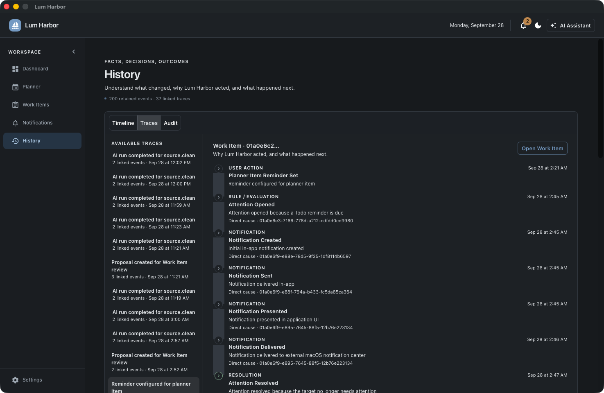

Trace 中 **Direct cause** 表示直接因果前驱；其他事件可能共享同一个 Source 或 approved change，但不是直接父子。常见链路：Assistant intent → AI Run → Proposal → Apply → WorkItem change；Reminder Set → Attention Opened → Notification Created/Sent/Presented/Delivered → Resolved；Apple Source observed → external Planner item created/updated。

## 16. 重启与持久化

正常冷重启会保留 WorkItem、Workflow、Tracked Item state/dependency、MonitorPoint、Todo、Reminder、Attention、Notification、Source、Proposal 和 History。Pending Proposal 会跨重启继续可审查；stopped Instance 仍停止，enabled Instance 会再次解析。

Plugin install、Instance config、Stop Using、Use Again 与 Remove 都要求重启，因为 discovery/runtime composition 在一个进程生命周期内固定。

Shutdown 时仍在执行的 AI 操作会被标为失败，而不是永远停留在 RUNNING。V1 不自动 retry；应检查失败原因后重新提交或显式 Interpret。

V1 没有 Backup/Restore；保护本地应用数据目录目前是 OS 或管理员责任。

## 17. 常用操作

### 创建新项目

1. 打开 **AI Assistant**。
2. 输入 “Create a work item called Q4 Release.”
3. 打开 Suggested Change，核对并 Apply。
4. 在 **Work Items** 打开新对象。

### 添加 Workflow、Tracked Item 与依赖

在 WorkItem 上下文中，一次提交并审查一个 mutation：

1. “Create a workflow with Design, Development, Testing, and Release.”
2. 分别添加 Backend API、Frontend UI、Deployment。
3. 让 Frontend UI depend on Backend API。
4. 让 Deployment depend on Frontend UI。

### 创建 Todo 与 Reminder

1. 用 Assistant 创建带绝对日期、时间与 timezone 的 Todo，或在 WorkItem 中使用 **Schedule Action**。
2. 核对并 Apply。
3. 在 Planner 打开 Todo，设置一个或多个 reminder threshold。
4. 完成 Todo，确认 Reminder 变为 **Satisfied**。

### 解释一条通知

1. 在 **Notifications** 阅读 reason。
2. 使用 **Open Todo/Open Item** 打开对象。
3. 到 **History → Traces**，从起因跟踪到解决。

## 18. 当前 V1 边界

- Workflow 没有 lifecycle/completion state。
- 没有 recurring Todo 或 recurring Workflow action engine。
- Plugin 不支持 hot reload、marketplace、remote registry、自动更新或 replace-in-place。
- 没有 Backup/Restore。
- Planner 没有通用 edit、archive/delete、reopen UI。
- 没有通用 Source→Tracking 自动映射。
- MonitorPoint 不能编辑、改期、重新激活或自动满足。
- 没有通用 calendar-event 创建路径。
- Dashboard 仍缺完整 Attention、recent changes、notification summary 与 system health 卡片。
- 没有 System runtime page 或 **Run Now** background-job control。
- 原生 Windows runtime 尚未完整产品验证。

详细问题处理见[运行时与故障排查](runtime-and-troubleshooting.md)。这些是当前边界，不是路线图承诺。
